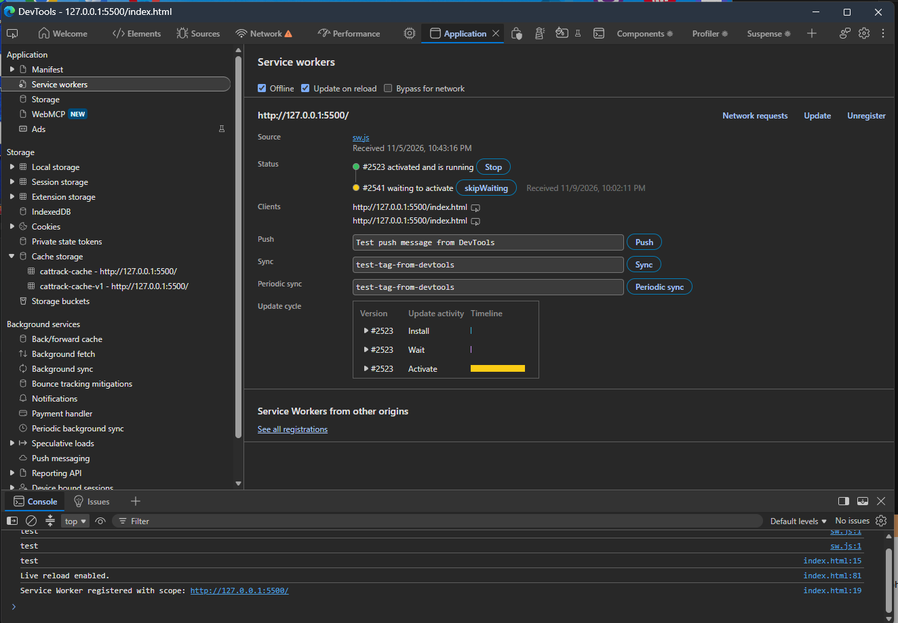
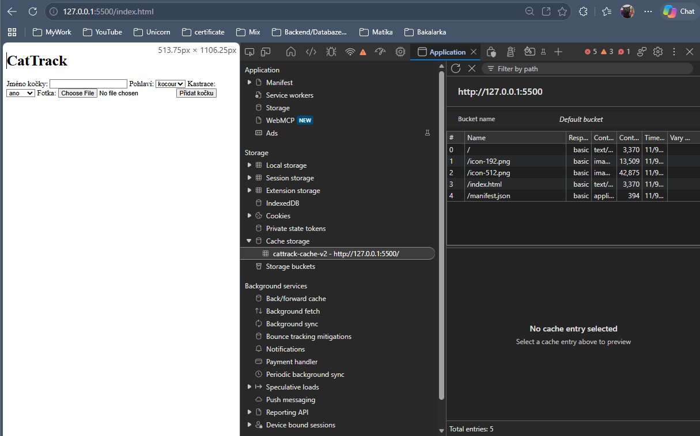
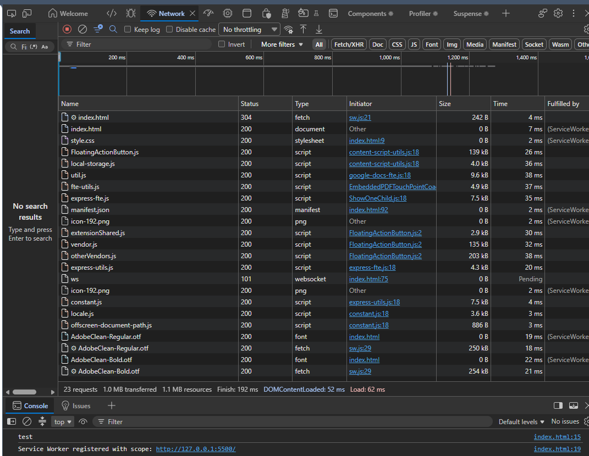

https://web.dev/learn/pwa/service-workers

 (ctrl+shift+v)

- docela dobrej poznatek do kapitoly 6, nasazeni applikace protoze kdyz zmenim sw.js prohlizec naintaluje novy SW ale ten ceka, start SW bezi dal, doud ho pouziva aspon jeden klient (a to muze byt zalozka v prohlzieci nebo okno naiinstalovane appky)
- ja ho mela jak v prohlziace tak z plochy = proste dva klienty
- dusledek pro dobrovolniky - nova verze appky dostanou az po upnem zavreni appky
- ofc ja to muzu obejit tlacitkem skipWaiting (jen pro vyvoj)
--------------------------------------------------------------------------------

- prohlizec ma svou vlastni kratodobou pamet, ktera muze zakryt chybu v cache SW
- cahtches.match() proheldava vsechyn caceh, i stare verze !!!!
-> takze se proste mus ismazat v ativate .. 

https://web.dev/articles/service-worker-lifecycle

https://developer.mozilla.org/en-US/docs/Web/API/CacheStorage/keys

https://developer.chrome.com/docs/devtools/storage/cache

https://developer.chrome.com/docs/devtools/progressive-web-apps

https://developer.chrome.com/docs/devtools/application

https://git-scm.com/book/en/v2/Git-Basics-Getting-a-Git-Repository

